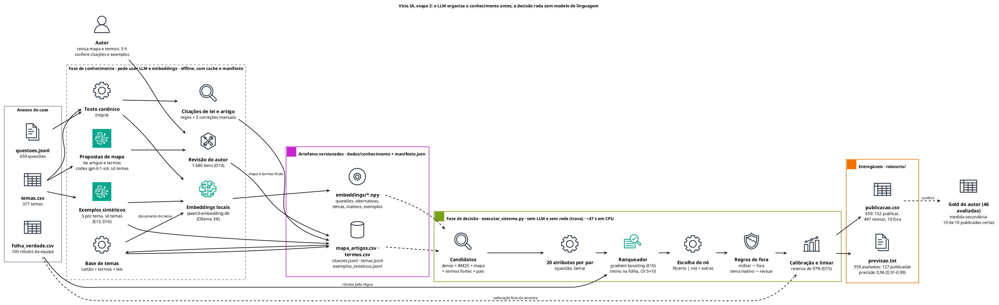

# Classificação de tópicos de questões jurídicas: case Vício (Método VDE), etapa 2

Para cada uma das **659 questões** de Penal, Processo Penal, Legislação Penal Especial e Criminologia, o sistema
decide entre **publicar** (vai direto para o aluno, num tema da árvore de 377 temas), **revisar** (vai para o
professor, com uma sugestão) ou **fora** (nenhum tema serve). A régua é **95% de acerto nas publicadas**,
publicando o máximo possível.

Na etapa 2, a regra mudou:
- **O LLM pode entrar antes da decisão,** sempre documentado e versionado: embeddings, extração de lei e artigo,
  enriquecimento dos temas, e termos e exemplos propostos, revisados e guardados como dado.
- **Na hora de classificar, nenhum modelo de linguagem é chamado.** O sistema roda com a rede bloqueada.

Por isso a solução tem duas fases:
- uma **fase de conhecimento**, offline, que produz artefatos versionados com a origem de cada um;
- uma **fase de decisão** que só lê esses artefatos.



- Enunciado: [`docs/enunciado/`](docs/enunciado/) (o case original e os ajustes da etapa 2).
- Plano e decisões de arquitetura, em ADRs: [`docs/adr/README.md`](docs/adr/README.md). As ADRs da etapa 2 são a
  018 a 027.
- A entrega da etapa 1 está no commit `02d7e19` e em [`relatorio/etapa1/`](relatorio/etapa1/).

## Resultado

| Entregável | Conteúdo |
|---|---|
| [`relatorio/etapa2/publicacao.csv`](relatorio/etapa2/publicacao.csv) | As 659 questões no formato do LEIA-ME: 152 publicar, 497 revisar (todas com tema sugerido e motivo) e 10 fora |
| [`relatorio/etapa2/previsao.txt`](relatorio/etapa2/previsao.txt) | Para as 559 avaliadas: precisão prevista **0,96** (0,91–0,99) e cobertura **0,23** (127 publicadas), e como chegamos nesses números |
| [`relatorio/etapa2/relatorio.md`](relatorio/etapa2/relatorio.md) ([PDF](relatorio/etapa2/relatorio.pdf), 4 páginas) | Relatório (a: sistema; b: os 100 rótulos; c: diagnóstico; d: produção) e memo para o professor (e) |
| [`relatorio/etapa2/arquitetura.png`](relatorio/etapa2/arquitetura.png) | As duas fases (fonte PlantUML em [`relatorio/diagramas/`](relatorio/diagramas/), com o diagrama de produção) |
| [`decisoes_manuais.md`](decisoes_manuais.md) | Toda decisão tomada à mão (D1 a D16), com o porquê |
| [`saidas/experimentos/registro.md`](saidas/experimentos/registro.md) | Pré-registro e resultado de cada experimento (E0 a E14), inclusive os descartados |
| [`saidas/sistema/graficos.md`](saidas/sistema/graficos.md) | Confiabilidade e precisão × cobertura (folha fora da amostra e estimativa nas 559), com as tabelas |
| [`saidas/sistema/diagnostico.md`](saidas/sistema/diagnostico.md) | Desempenho fora da amostra, calibração, curva do limiar e contagem das decisões |
| [`saidas/etapa2/gold_secundario.md`](saidas/etapa2/gold_secundario.md) | Checagem independente com o gold manual do autor: 10 publicadas, as 10 certas |

## Como rodar

### 1. Pré-requisitos

- [uv](https://docs.astral.sh/uv/). Ele instala o Python 3.12 (fixado em `.python-version`), se faltar.
- Os anexos da etapa 2 já vêm no repositório, como foram recebidos, em [`anexos/2-ENTREGA/`](anexos/2-ENTREGA/):
  `questoes.jsonl`, `temas.csv`, `folha_verdade.csv`, `LEIA-ME.md` e `entrega_modelo.csv`.
- Só para **regerar** a fase de conhecimento:
  - o [Ollama](https://ollama.com), para os embeddings;
  - a CLI `codex`, para as propostas de termos e de exemplos.

  A decisão não precisa de nenhum dos dois.

### 2. Ambiente

```bash
uv venv                                  # cria .venv com Python 3.12
uv pip install -r requirements.txt       # execução
uv pip install -r requirements-dev.txt   # e, para desenvolver, as ferramentas de checagem
```

### 3. A entrega: um comando, sem LLM e sem rede

```bash
uv run python executar_sistema.py    # gera relatorio/etapa2/publicacao.csv e previsao.txt
uv run python executar_validacao.py  # confere os dois contra o LEIA-ME
```

- **O que o comando lê:**
  - os anexos;
  - as questões preparadas (`dados/preparados/`);
  - os artefatos versionados de `dados/conhecimento/`: base de temas, mapa de artigos, termos, citações, exemplos
    sintéticos e vetores de embedding.
- **Como trabalha:**
  1. treina o ranqueador nas 100 questões da folha-verdade;
  2. mede fora da amostra (validação cruzada, 5 partes × 10 repetições);
  3. calibra, escolhe o limiar e decide as 659.
- **Tempo:** cerca de **47 s** em CPU, neste notebook. Quase tudo é treino da validação cruzada; aplicar o modelo
  leva segundos.
- **Determinismo:** a saída é igual byte a byte entre execuções, inclusive com uma thread só e num clone limpo do
  repositório, sem rede (reprodução feita pelo autor). SHA-256 esperados:
  - `publicacao.csv`: `75577604df2f7616226d08afbf564b58eec0b67fab1d30f02608fed492426889`
  - `previsao.txt`: `18ccb6faf1cc7c0102c7dfdf054f35a05a70dd4613245a5ab5988fe6fddfea4f`
- **Gráficos:** o comando também gera os gráficos de confiabilidade e de precisão × cobertura em `saidas/sistema/`.
- **Tempo e contagens da execução:** ficam em `saidas/sistema/execucao.json`.

**A trava:**
- O `executar_sistema.py` liga `VICIO_SEM_LLM=1`, e a fábrica de provedores de LLM se recusa a criar qualquer
  provedor.
- A `TravaSemLLM` bloqueia as conexões de rede durante a execução.
- Um teste do portão de qualidade (`testes/teste_fronteira_llm.py`) proíbe, no código da decisão
  (`vicio_ia/sistema/` e `executar_sistema.py`), imports de LLM, de rede e da decisão da etapa 1.

### 4. Fase de conhecimento: como os artefatos foram feitos

Só é preciso rodar para regerar os artefatos; eles já estão versionados. Em ordem:

| # | Comando | O que faz | Modelo | Tempo medido |
|---|---|---|---|---|
| 1 | `executar_preparacao.py` | Texto canônico das 659 questões e árvore preparada (D1 a D4, D13) | nenhum | segundos |
| 2 | `executar_enriquecimento.py` | Propostas de mapa lei/artigo → tema e de termos, só a partir dos temas (nenhuma questão entra na chamada) | `codex` `gpt-6.1-sol` | 62 chamadas em 15 min; com o cache `runs/conhecimento/`, segundos |
| 3 | `executar_revisao_conhecimento.py` | Revisão do autor: 568 linhas do mapa, 797 termos de risco e uma amostra de 315 (D14) | — (humano) | 3 h |
| 4 | `executar_citacoes.py` | Leis e artigos citados, por regex, mais 3 correções manuais (`citacoes_manuais.csv`) | nenhum | ~1 s |
| 5 | `executar_base_temas.py` | Base de temas: cartão, mapa e termos revisados e os IDs da folha (`temas.jsonl`) | nenhum | ~1 s |
| 6 | `executar_exemplos.py` | 3 questões-modelo por tema, só a partir dos temas (E13, D16) | `codex` `gpt-6.1-sol` | 62 chamadas em 26 min; com o cache `runs/exemplos/`, segundos |
| 7 | `executar_embeddings.py` | Vetores dos 5 modelos candidatos (E8), do documento do tema (E8b) e dos exemplos; exporta o `qwen3-embedding:4b` | Ollama, local | ~50 min na primeira vez (GPU de 6 GB); com o cache `runs/embeddings/`, ~4 s |
| 8 | `executar_avaliacao_etapa2.py` | Experimentos E7, E7b, E11, E11b, E12 e E10 e a medida secundária com o gold | nenhum | ~45 s |

- **Cache dos modelos:** com o cache de `runs/`, os passos 2 e 6 refazem tudo sem chamar o modelo.
- **Embeddings:** o cache de `runs/embeddings/` não é versionado (são 5 modelos). Sem ele, o passo 7 exige o
  Ollama com os modelos candidatos (`ollama pull qwen3-embedding:4b` e os outros de `ParametrosEmbeddings`).
- **Configuração:** caminhos, limiares e modelos ficam em [`vicio_ia/configuracao.py`](vicio_ia/configuracao.py).
  Todo ponto de entrada roda **sem argumentos**.

### 5. Provedores de LLM (só na fase de conhecimento)

- **Camada:** as chamadas passam pela camada `vicio_ia/llm/` ([ADR-017](docs/adr/00-fundacao/ADR-017-provedores-plugaveis-e-analise-de-infra.md)),
  com cache só de acréscimo em `runs/`.
- **Provedores da etapa 2:**
  - `codex-cli`, a CLI `codex` com login do ChatGPT;
  - `ollama`, local, para os embeddings.
- **Outros provedores** (`claude-api`, `openai`, `huggingface`) usam chaves num `.env`, que o git ignora (modelo em
  [`.env.example`](.env.example)). As chaves nunca são impressas nem gravadas.
- **Custo pago:** nenhum. A etapa 2 usou só a assinatura e a máquina local.

## Tempo gasto

- **Máquina:**
  - decisão: ~47 s;
  - avaliação: ~45 s;
  - fase de conhecimento do zero: cerca de 1 h 30 min (15 min de propostas, 26 min de exemplos e ~50 min de
    embeddings);
  - tudo a partir do cache: menos de 2 min.
- **Autor:** o tempo total não foi cronometrado.
  - A revisão do mapa de artigos e dos termos, a maior parte do trabalho manual, levou 3 h (D14).
  - O resto foi a conferência das citações e dos pendentes, a revisão da conferência dos exemplos sintéticos (D16)
    e as decisões registradas em `decisoes_manuais.md`.

## De onde veio cada artefato

O detalhe, com o hash de cada arquivo, está em [`dados/conhecimento/manifesto.json`](dados/conhecimento/manifesto.json).

| Artefato | Origem | Comando | Revisão humana |
|---|---|---|---|
| `anexos/2-ENTREGA/` | Equipe da Vício, como recebido | — | — |
| `dados/preparados/` (questões e árvore) | Regra, sem modelo | `executar_preparacao.py` | Conferência manual de 20 questões novas (D13) e decisões sobre a árvore (D1 a D4) |
| `dados/temas/cartoes.jsonl` | LLM, na etapa 1 (D7) | `executar_cartoes.py` (etapa 1) | Ajustes pontuais em `cartoes_ajustes.csv` |
| `dados/conhecimento/mapa_artigos.csv` | LLM (`codex` `gpt-6.1-sol`, só temas) e revisão | `executar_enriquecimento.py` → `executar_revisao_conhecimento.py` | 100% das linhas revisadas pelo autor (D14) |
| `dados/conhecimento/termos.csv` | LLM (`codex` `gpt-6.1-sol`, só temas) e revisão | idem | Termos de risco revisados pelo autor; amostra de 315 com 3,2% de erro; 2.833 termos não revisados, marcados com `revisado = nao` (D14) |
| `dados/conhecimento/citacoes.jsonl` | Regra (regex) e 3 correções manuais | `executar_citacoes.py` | Amostra de 20 conferida pelo autor (20 de 20 certas) e os 3 pendentes resolvidos à mão (D14) |
| `dados/conhecimento/temas.jsonl` | Regra (montagem dos artefatos acima) | `executar_base_temas.py` | A dos artefatos de entrada |
| `dados/conhecimento/exemplos_sinteticos.jsonl` | LLM (`codex` `gpt-6.1-sol`, só temas) | `executar_exemplos.py` | Amostra de 30 conferida pelo assistente (LLM), com a conferência revisada e aceita pelo autor (D16); o restante é rascunho do modelo |
| `dados/conhecimento/embeddings/` | Embedding local `qwen3-embedding:4b` (digest `df5bd2e3c74c`) | `executar_embeddings.py` | — |
| `dados/conhecimento/propostas/` | LLM, sem revisão; **não é usado pelo sistema** | `executar_enriquecimento.py` e o assistente (antitemas) | — |
| `dados/gold/` | Autor, à mão, sem LLM (etapa 1) | `executar_rotulagem.py` | — (só medida secundária, fora do treino) |
| `runs/` | Respostas brutas dos modelos (cache) | os passos com modelo | — |

## Padrão de código

Definido na [ADR-001](docs/adr/00-fundacao/ADR-001-stack-e-ambiente.md) e conferido pelo `executar_checagem.py`:

- **Orientado a objetos:** cada etapa é um subpacote de `vicio_ia/`, com uma classe orquestradora e um
  `executar_<etapa>.py`.
- **Sem argumentos de linha de comando,** sem `*args` nem `**kwargs`. A configuração fica em dataclasses congeladas.
- **Tudo tipado,** inclusive variáveis locais. Alvos de `for` e `with` são declarados antes.
- **Docstrings** em português, em módulos, classes e funções.
- **Dependências fixadas** com `==` em `requirements.txt` e `requirements-dev.txt`.
- **Testes** com `unittest`, em `testes/`.
- **Portão de qualidade:** ruff, mypy estrito, testes e anotações. Precisa passar antes de cada entrega:

```bash
uv run python executar_checagem.py
```

## Estrutura do repositório (etapa 2)

```
├── executar_sistema.py            ← a entrega: decisão sem LLM (publicacao.csv e previsao.txt)
├── executar_validacao.py          ← confere os entregáveis contra o LEIA-ME
├── executar_preparacao.py         ← passo 01: texto canônico e árvore preparada
├── executar_enriquecimento.py     ← propostas de mapa de artigos e de termos (LLM, só temas)
├── executar_revisao_conhecimento.py ← revisão interativa do autor
├── executar_citacoes.py           ← citações de lei e artigo (regex)
├── executar_base_temas.py         ← base de conhecimento dos temas
├── executar_exemplos.py           ← exemplos sintéticos por tema (LLM, só temas)
├── executar_embeddings.py         ← vetores (Ollama), E8 e exportação
├── executar_avaliacao_etapa2.py   ← experimentos na folha e medida secundária com o gold
├── executar_checagem.py           ← portão de qualidade
├── relatorio/                     ← entregáveis e relatório por etapa (etapa2/, etapa1/) e fontes dos diagramas
├── decisoes_manuais.md            ← decisões tomadas à mão (D1 a D16)
├── vicio_ia/
│   ├── sistema/                   ← fase de decisão, sem LLM: pares, ranqueador, política, pipeline, experimentos
│   ├── enriquecimento/            ← fase de conhecimento: propostas, revisão, citações, base de temas, exemplos, embeddings
│   ├── llm/                       ← contrato e provedores de LLM e de embedding, cache, custo
│   ├── preparacao/, temas/, entrega/ ← passo 01, cartões da etapa 1, validador
│   └── (classificacao/, decisao/, avaliacao/ ← etapa 1; bloqueados na etapa 2 pela GuardaEtapa)
├── dados/
│   ├── conhecimento/              ← artefatos versionados da etapa 2 e o manifesto
│   ├── preparados/, temas/, gold/ ← questões preparadas, decisões sobre a árvore, gold do autor
├── saidas/
│   ├── sistema/                   ← diagnóstico e tempo da decisão
│   ├── etapa2/                    ← relatórios dos experimentos da etapa 2
│   └── experimentos/registro.md   ← pré-registro e resultados (E0 a E14)
├── prompts/                       ← prompts versionados (a versão entra na chave do cache)
├── runs/                          ← cache das chamadas a modelos (os embeddings ficam fora do git)
├── testes/, ferramentas/          ← testes unitários e portão de qualidade
├── docs/adr/                      ← ADRs (etapa 2: 08-etapa2/)
└── anexos/1-ENTREGA/, anexos/2-ENTREGA/ ← dados do case, como recebidos
```

## Etapa 1

- **Onde está:** a entrega da etapa 1 (359 questões, ensemble de LLMs na decisão, 81 publicadas) está no commit
  `02d7e19` e em [`relatorio/etapa1/`](relatorio/etapa1/).
- **Por que os comandos não rodam aqui:** os comandos da etapa 1 que chamam LLM na decisão se recusam a rodar
  com a etapa 2 em vigor (`GuardaEtapa`).
- **Para reproduzir a etapa 1:** `git checkout 02d7e19`.
