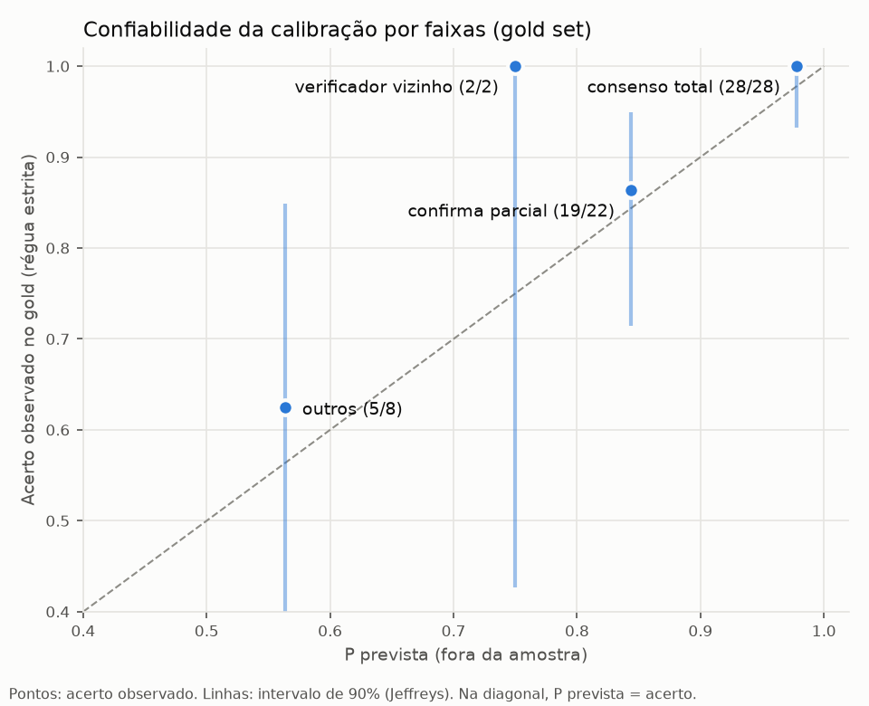
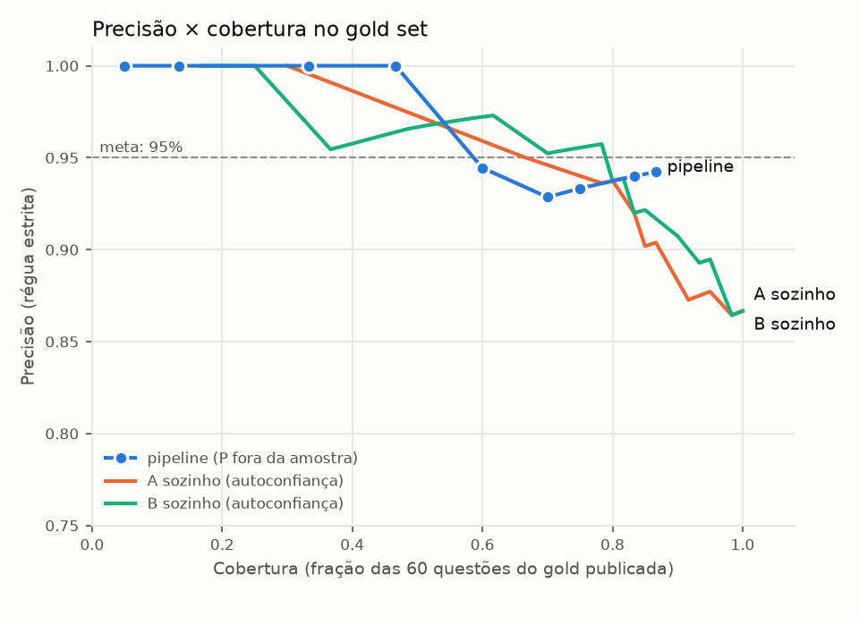
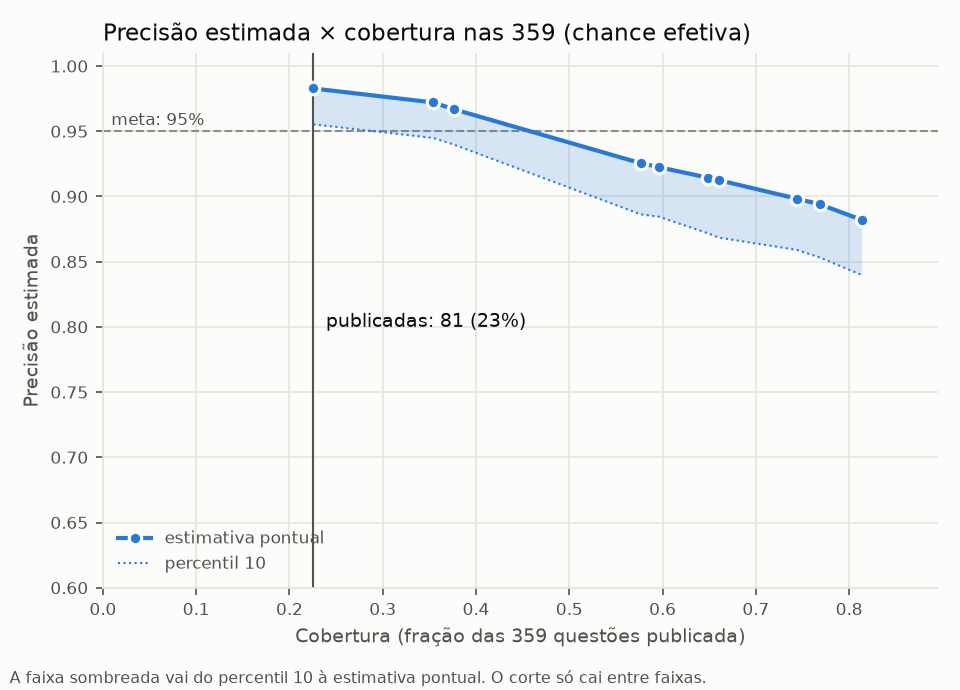

# Gráficos de avaliação (ADR-013)

Gold set: 60 questões, régua estrita. Calibrador: faixas de sinais com suavização de Jeffreys. A P de cada questão do gold vem
de um calibrador ajustado sem ela (validação cruzada em 5 partes).

## Confiabilidade

| Faixa | Questões | P prevista (fora da amostra) | Acerto observado | Intervalo de 90% |
|---|---:|---:|---:|---|
| consenso total | 28 | 0.978 | 1.000 | 0.932–1.000 |
| confirma parcial | 22 | 0.844 | 0.864 | 0.715–0.950 |
| verificador vizinho | 2 | 0.750 | 1.000 | 0.426–0.999 |
| outros | 8 | 0.564 | 0.625 | 0.342–0.849 |

## Precisão × cobertura no gold

| Sistema | Publicadas | Cobertura | Precisão |
|---|---:|---:|---:|
| pipeline | 3 | 0.05 | 1.000 |
| pipeline | 8 | 0.13 | 1.000 |
| pipeline | 20 | 0.33 | 1.000 |
| pipeline | 28 | 0.47 | 1.000 |
| pipeline | 36 | 0.60 | 0.944 |
| pipeline | 42 | 0.70 | 0.929 |
| pipeline | 45 | 0.75 | 0.933 |
| pipeline | 50 | 0.83 | 0.940 |
| pipeline | 52 | 0.87 | 0.942 |
| A sozinho | 18 | 0.30 | 1.000 |
| A sozinho | 40 | 0.67 | 0.950 |
| A sozinho | 47 | 0.78 | 0.936 |
| A sozinho | 48 | 0.80 | 0.938 |
| A sozinho | 50 | 0.83 | 0.920 |
| A sozinho | 51 | 0.85 | 0.902 |
| A sozinho | 52 | 0.87 | 0.904 |
| A sozinho | 55 | 0.92 | 0.873 |
| A sozinho | 56 | 0.93 | 0.875 |
| A sozinho | 57 | 0.95 | 0.877 |
| A sozinho | 59 | 0.98 | 0.864 |
| A sozinho | 60 | 1.00 | 0.867 |
| B sozinho | 10 | 0.17 | 1.000 |
| B sozinho | 14 | 0.23 | 1.000 |
| B sozinho | 15 | 0.25 | 1.000 |
| B sozinho | 22 | 0.37 | 0.955 |
| B sozinho | 29 | 0.48 | 0.966 |
| B sozinho | 31 | 0.52 | 0.968 |
| B sozinho | 35 | 0.58 | 0.971 |
| B sozinho | 37 | 0.62 | 0.973 |
| B sozinho | 42 | 0.70 | 0.952 |
| B sozinho | 43 | 0.72 | 0.953 |
| B sozinho | 47 | 0.78 | 0.957 |
| B sozinho | 48 | 0.80 | 0.938 |
| B sozinho | 49 | 0.82 | 0.939 |
| B sozinho | 50 | 0.83 | 0.920 |
| B sozinho | 51 | 0.85 | 0.922 |
| B sozinho | 54 | 0.90 | 0.907 |
| B sozinho | 56 | 0.93 | 0.893 |
| B sozinho | 57 | 0.95 | 0.895 |
| B sozinho | 59 | 0.98 | 0.864 |
| B sozinho | 60 | 1.00 | 0.867 |

## Precisão estimada × cobertura nas 359

| Publicadas | Cobertura | Precisão estimada | Percentil 10 |
|---:|---:|---:|---:|
| 81 | 0.226 | 0.983 | 0.955 |
| 127 | 0.354 | 0.972 | 0.945 |
| 135 | 0.376 | 0.967 | 0.940 |
| 207 | 0.577 | 0.925 | 0.886 |
| 214 | 0.596 | 0.922 | 0.884 |
| 233 | 0.649 | 0.914 | 0.872 |
| 237 | 0.660 | 0.913 | 0.868 |
| 267 | 0.744 | 0.898 | 0.859 |
| 276 | 0.769 | 0.894 | 0.853 |
| 292 | 0.813 | 0.882 | 0.840 |
