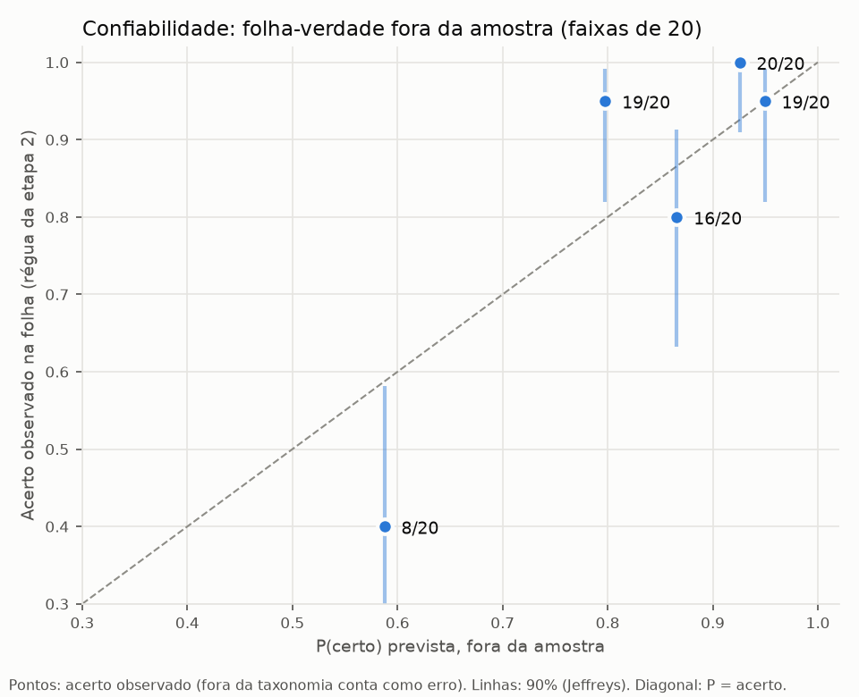
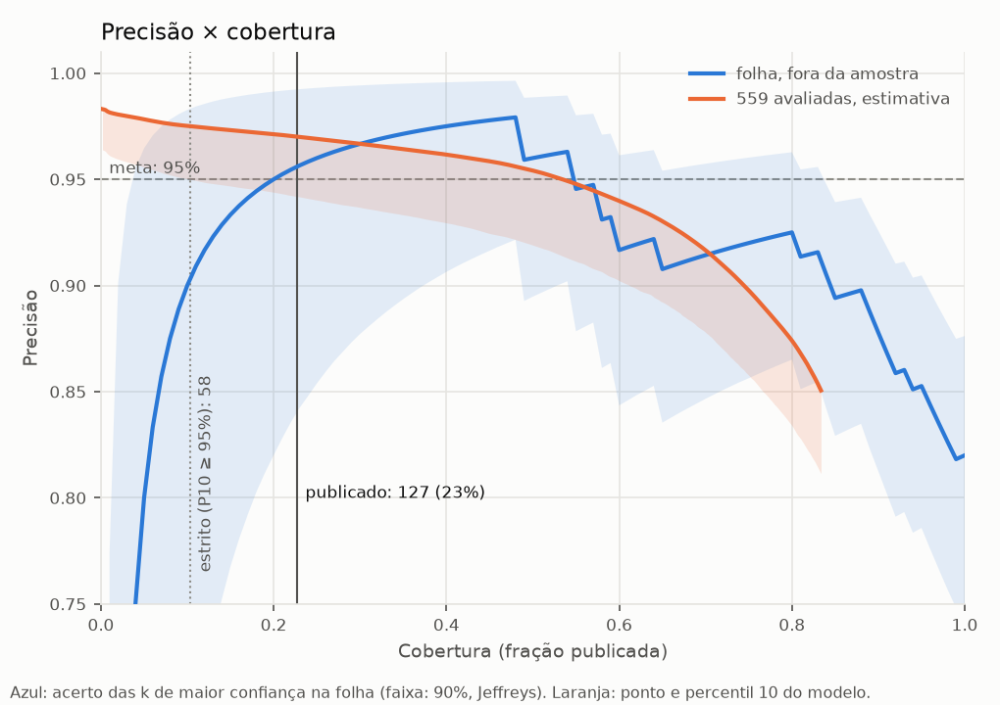

# Gráficos da etapa 2

| Faixa (20 questões) | P média prevista | Acerto observado | Intervalo de 90% |
|---:|---:|---:|---|
| 1 | 0.588 | 8/20 (40%) | 0.24–0.58 |
| 2 | 0.798 | 19/20 (95%) | 0.82–0.99 |
| 3 | 0.866 | 16/20 (80%) | 0.63–0.91 |
| 4 | 0.926 | 20/20 (100%) | 0.91–1.00 |
| 5 | 0.950 | 19/20 (95%) | 0.82–0.99 |

| Questões da folha (maior P primeiro) | Precisão observada | Intervalo de 90% |
|---:|---:|---|
| 10 | 90% | 0.67–0.98 |
| 20 | 95% | 0.82–0.99 |
| 30 | 97% | 0.88–0.99 |
| 40 | 98% | 0.91–1.00 |
| 50 | 96% | 0.89–0.99 |
| 60 | 92% | 0.84–0.96 |
| 70 | 91% | 0.85–0.96 |
| 80 | 92% | 0.87–0.96 |
| 90 | 88% | 0.81–0.93 |
| 100 | 82% | 0.75–0.88 |

Nas 559 avaliadas: 127 publicadas (precisão prevista 0.96, 0.91–0.99); pelo critério estrito (percentil 10 ≥ 95%), seriam 58.
